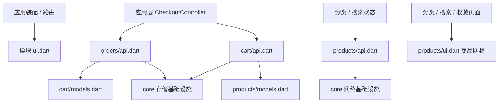
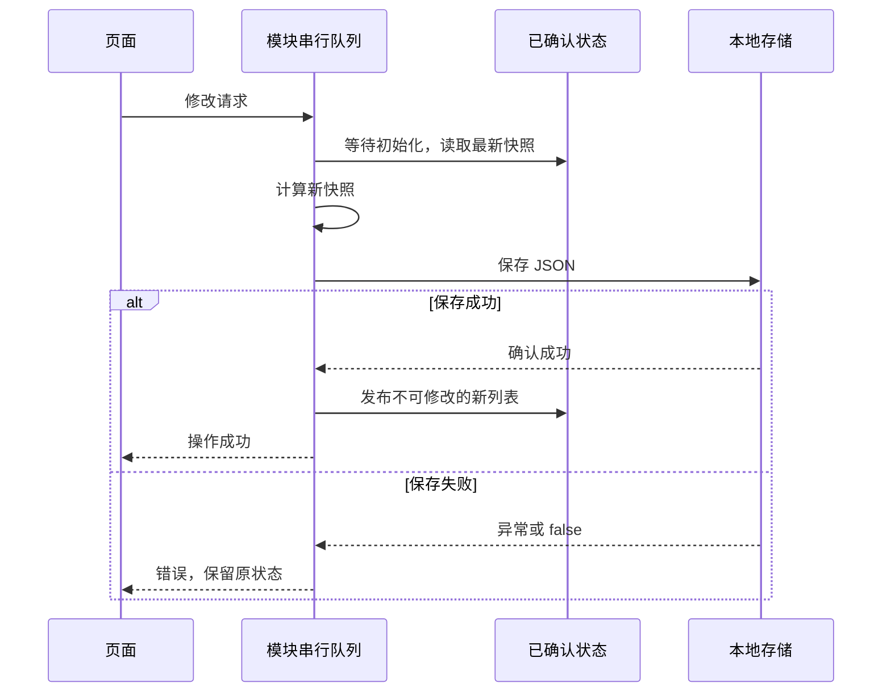

# WanShop 架构维护说明

这是 M0–M13 完成后的维护演进。保留课程标记与 iOS 类比，以当前源码为准；
历史提交仍可用于理解单例、页面编排等起步方案如何演进。

## 1. 模块边界与装配

按业务组织 `features/`，每个模块保留 data / domain / presentation。
跨模块只使用以下入口，入口通过 `show` 限定导出，不是导出全部内部文件的“万能桶”：

| 入口 | 允许导出 | 使用者 |
|---|---|---|
| `models.dart` | 业务模型 | 需要商品/购物车/订单类型的其他模块 |
| `api.dart` | 状态查询、修改能力、明确共享的依赖入口 | 业务页面、应用层协调器 |
| `ui.dart` | 页面、需要共享的业务组件 | 路由装配、分类/搜索/收藏商品网格 |

模型继续归业务模块，不能因为被复用就把 Product、CartItem 搬进 core。
core 负责网络、错误、存储适配、串行任务队列和通用 UI 辅助。
同模块可以引用内部文件；模块测试可以引用内部类以验证其行为。
`test/architecture_boundary_test.dart` 检查生产代码的跨模块 import 规则。



入口不是业务互相调用的许可：数据层不能依赖其他模块的页面状态，跨模块流程由应用层协调。
页面可订阅公开状态并调用公开业务动作；UI 对应用协调器的依赖不能反向渗入领域模型。

Repository/Storage 装配放在 `data/*_dependencies.dart`，简单装配使用普通 Provider。
页面状态继续使用 `@riverpod` / `@Riverpod(keepAlive: true)` 生成 Notifier。
Dio 与 AuthStorage 统一在 `core/network/dio_client.dart` 装配；安全存储覆盖会同时作用于
Auth 和鉴权拦截器，客户端随 ProviderScope 销毁关闭。

```dart
final productsRepositoryProvider = Provider<ProductsRepository>(
  (ref) => ProductsRepository(dio: ref.watch(dioProvider)),
);
```

分类列表由 CategoriesRepository 请求；商品列表、详情、分类商品与搜索由 ProductsRepository 请求。
Repository 构造函数要求 Dio，不再暗中使用全局单例。业务异常类型不依赖 Dio；
`requestJson` 分别处理传输错误与模型解码错误，避免把未知编程错误全部归为解析失败。

## 2. 首页三态、分页与缓存

首页状态为 `AsyncValue<ProductFeedState>`。AsyncValue 管首屏三态，快照包含：

- `products`：不可修改的商品列表。
- `nextSkip` / `hasMore`：下一页偏移与是否继续分页。
- `isLoadingMore`：追加加载状态。
- `isFromCache`：是否来自离线兜底。
- `appendError`：追加失败原因，失败仍保留已有商品。

刷新重新 build，并增加请求代次；旧分页结果和旧 finally 都要检查代次。
多次加载更多共享同一个 Future；空页关闭 hasMore。Provider 销毁后迟到结果不再发布。
≈ iOS 使用 loadID 检查请求归属，不能只依赖取消能否成功。

首页缓存只保存首屏，是可丢弃副本：网络成功后后台保存，失败不改变网络成功状态；
网络 AppException 时尝试缓存，缓存读取失败或为空时保持原网络错误。
后台 Future 必须处理错误，不能用“不 await”来代替错误策略。
Dio Transformer 对坏 JSON 包装的 FormatException 同样归为 ParseException。

## 3. 本地主数据的修改契约

购物车、收藏、订单是本地数据真身，原键名与 JSON 格式保留：
`cart_items`、`favorite_products`、`orders`、`default_address`、`home_products_cache`。
无需数据迁移；模型生成与现有数据往返测试继续覆盖嵌套订单、枚举和时间。



`await future` 只等待初始化，不让两个修改互斥。`SerialTaskQueue` 排队的是整个读改存过程；
某项失败仍向调用方抛错，但队尾吸收失败以便下一项继续。
`clear()` 也等待初始读取，防止刚清空后旧磁盘结果又覆盖回来。

JsonPreferencesStore 复用 JSON 编解码，并检查 setString 返回值。
主数据解析失败保持错误态，不当作用户从未保存；缓存副本允许降级。
页面 await 动作再提示成功。保存失败不能让滑动删除先把行从界面移走：
购物车使用 confirmDismiss 等待保存结果；商品动作和数量修改在提交中禁用。
这里的确认表示存储插件返回成功，不承诺物理落盘时刻或跨键事务。

## 4. 结算检查点与重试

CheckoutController 在应用层消费 cart / orders 公开入口。
页面负责表单校验、提示与导航；Orders 不调用购物车状态，也不持有页面上下文。

1. 冻结提交时的购物车列表，创建并保存订单；保存失败保持原订单状态，可以重新提交。
2. 保存订单成功后记录订单对象；只有此时才替换上一单有效检查点。扣除购买快照数量，不清空整个购物车。
3. 保存最近默认地址，成功后 invalidate savedAddressProvider。
4. 返回 CheckoutResult，由页面判断导航或显示待恢复步骤。

| 失败位置 | 结果 | 重试行为 |
|---|---|---|
| 订单保存 | 本次未成功创建订单 | 重新提交，仍从当前购物车建立快照 |
| 购物车扣量保存 | 订单已创建，购物车待同步 | 仅扣量，不新建订单 |
| 默认地址保存 | 订单已创建，附属偏好未保存 | 订单页重试保存地址，不重复扣量 |

CartSnapshot 在购物车队列内同时捕获行与累计新增数量。扣量时优先保留选择后新增的数量，
即使用户删除后重新加入同款，也不会误扣新加入的行；数量减少后的分配同样优先保留新增部分。
计数只在当前会话使用，不写入旧 JSON。

提交中重复调用共享同一任务。已完成步骤用检查点标志跳过；离开页面不清除检查点。
待扣量订单完成前优先恢复旧结算。购物车已处理但地址未保存时，新的结算以新订单地址
作为最新默认地址，旧地址不再恢复。检查点只保留当前应用会话的最近一次尝试。

边界：没有真实订单后端、跨存储原子事务、服务端幂等键或进程重启恢复。
若进程在订单保存与购物车扣量之间退出，需人工核对本地订单与购物车；未来真实后端接入
必须另行设计持久化恢复和服务端幂等，不能把内存检查点当成支付/交易保证。

## 5. 国际化约定

支持 zh / en / de / ar（RTL），用户可在 App 内覆盖系统语言（`features/settings`）。
完整讲解见 [M12 进阶讲义](lessons/M12-国际化进阶-RTL与多语言.md)，维护时遵守：

- **界面文案只来自 ARB**。数据层抛带类型的 `AppException`（附 `NetworkIssue`、状态码等结构化字段），
  `message` 只是开发者诊断信息；页面统一用 `l10n.describeError(error)` 翻译。
  `AppException` 的翻译是**无默认分支**的 sealed switch，新增子类必须补文案。
  应用层业务异常（如 `CheckoutException`）实现 `LocalizedException` 自带文案；数据/领域层异常不实现它。
- **领域模型与常量不带文案**：枚举在展示层翻译（如 `order_status_text.dart`），
  `static const` 只存与语言无关的标识，构造参数默认值不能是文案。
- **数字、金额、百分比、日期走 ARB 占位符格式**；币种是业务事实（USD），不随语言变化。
  正负号、百分号也属于格式，不写进译文（负值直接传负数）。
  不解析、不比较格式化后的字符串（含 U+00A0、RLM/LRM 等不可见字符）。
- **翻译后的字符串不跨越 build 保存**：不放进常量、全局变量或路由 `extra`；需要时由稳定标识（slug、枚举）在 build 时翻译。
- 冷启动用 `deferFirstFrame` 等语言偏好读完再出首帧，`allowFirstFrame` 必须在成功和失败时都调用。
- **新增模板 key 必须写 description**（`required-resource-attributes`），同词不同语境用不同 key；
  `l10n_test.dart` 检查各语言 key 集合与占位符一致。
- **布局用逻辑方向**：左右不对称的间距/对齐用 `EdgeInsetsDirectional` / `AlignmentDirectional`；
  Row 中长度由翻译决定的文字要可伸缩并有截断或换行策略；电话、邮箱等输入固定 LTR，
  解析用户输入的数字前先 `normalizeDigits`。
- **兜底语言固定为 en**（`preferred-supported-locales`）。新增语言需同时更新 ARB、
  `Info.plist` 的 `CFBundleLocalizations`、Android `locales_config.xml` 与 `languageEndonym`。

## 6. 风格、文档与验证

- 中文注释解释机制与取舍，保留 M 模块历史标记；路径与示例描述当前实现。
- 使用 Dart 格式化与 directives_ordering，简单装配不额外生成无业务价值的 provider 类。
- `.g.dart` 由 `dart run build_runner build` 生成，l10n 由 `flutter gen-l10n` 生成，均不手改。
- 修改模块同步相关讲义的代码地图、自测与练习。课程索引见 [lessons/README.md](lessons/README.md)。
- 自动验证结果与真机/端到端验收分开记录，见 [VALIDATION.md](VALIDATION.md)。
